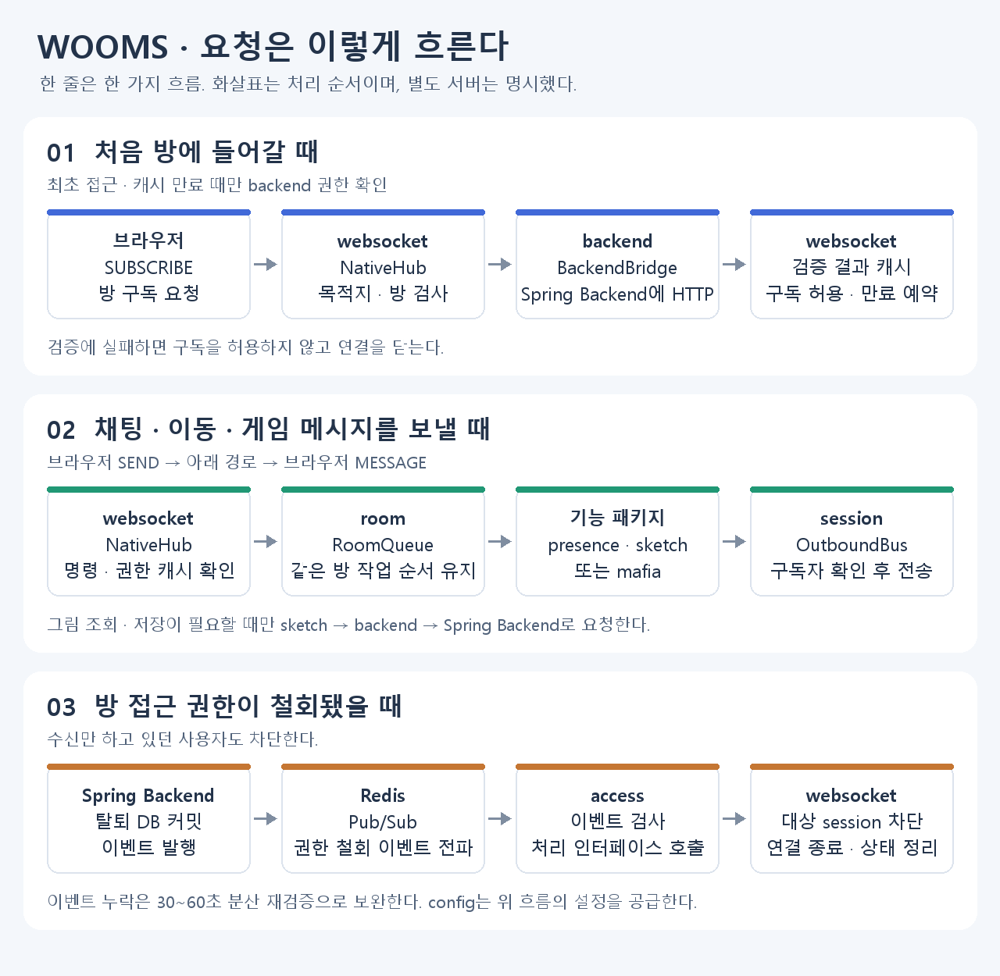
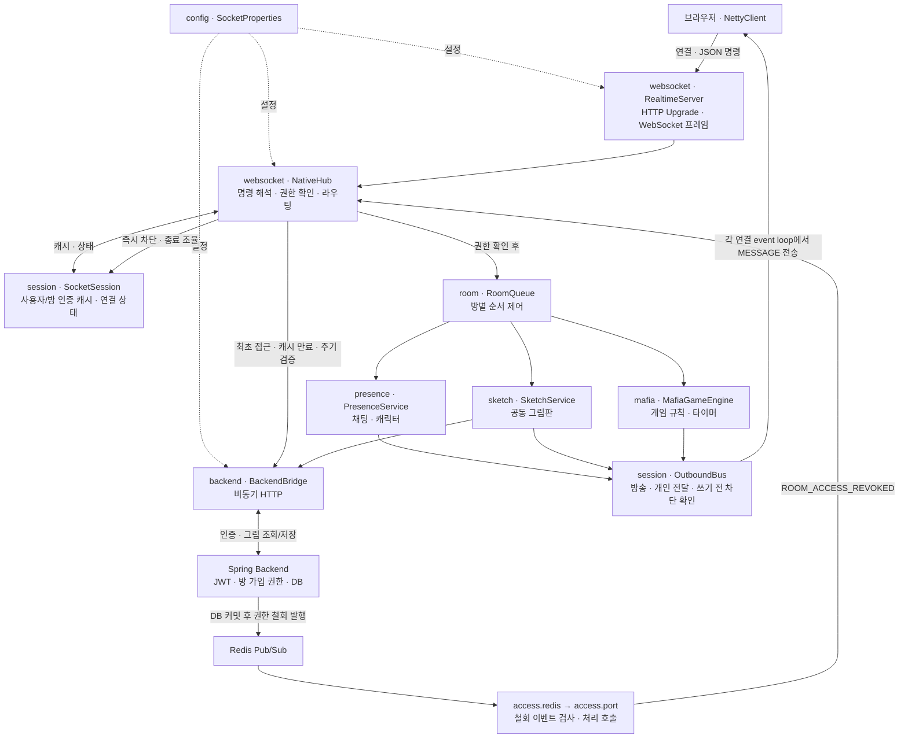
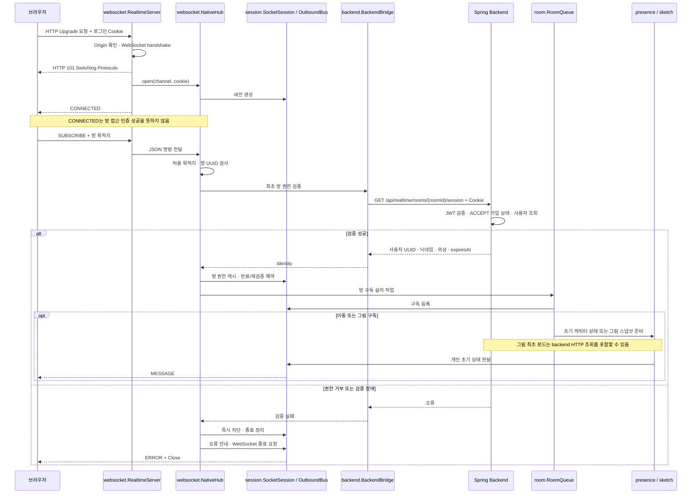
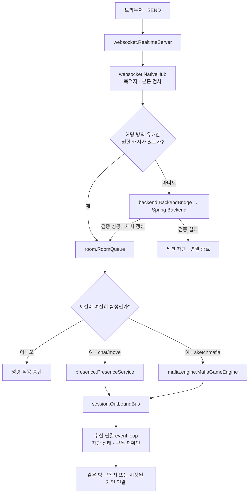
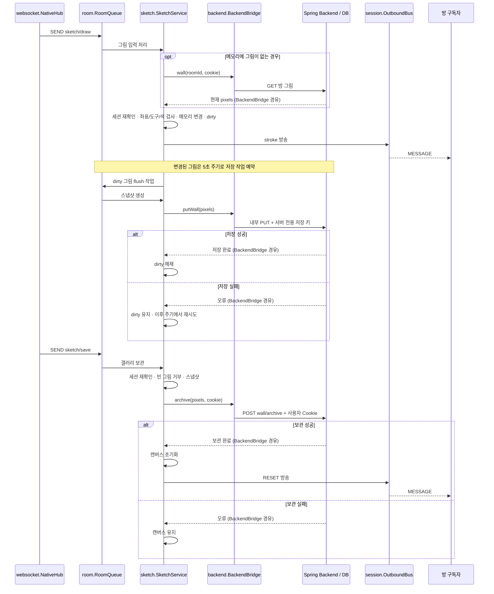
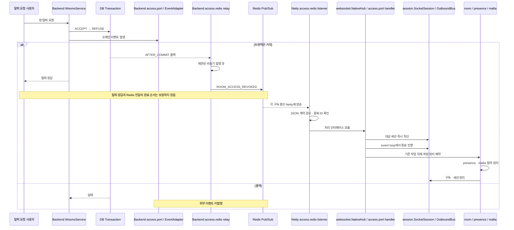
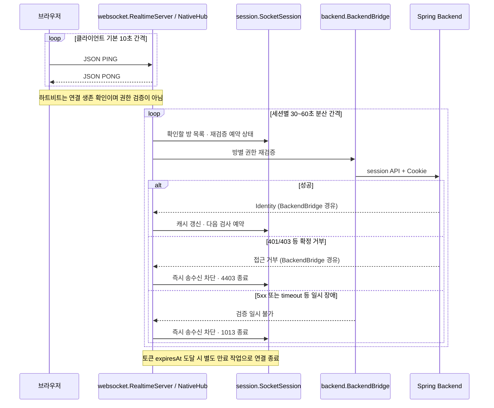

# 패키지별 요청 흐름

먼저 세 가지 주요 흐름을 왼쪽에서 오른쪽으로 읽는다. 아래 그림의 화살표는 처리 순서다.

권한 확인은 최초 접근·캐시 만료뿐 아니라 주기 재검증 때도 수행한다.
이하 Mermaid 다이어그램은 저장·실패 처리까지 포함하는 상세 참조다.

2026-11-03 작업본 기준. Mermaid를 지원하는 Markdown 뷰어와 GitHub에서 다이어그램을 볼 수 있다.
각 노드의 패키지는 별도 표기가 없으면 `com.ee06.mychat.realtime` 하위다.
화살표는 호출·데이터 흐름을 나타내며 같은 실행 스레드라는 뜻은 아니다.

## 1. 전체 구조

`config`는 시작 시 설정을 공급한다. 일반 메시지마다 거치는 요청 처리 단계는 아니다.
Redis는 권한 철회 전파에 사용하며 채팅·그림·게임 메시지의 전달 경로에는 들어가지 않는다.

## 2. 연결과 최초 방 구독

초기 상태용 개인 큐는 방 구독보다 먼저 구독해야 초기 응답을 받을 수 있다.
개인 큐 구독 자체가 방 데이터 접근을 승인하지는 않는다.

## 3. 채팅·이동·게임 메시지

유효한 캐시를 사용하는 이벤트는 backend를 매번 호출하지 않는다.
동기 상태 변경과 권한 철회는 세션 monitor를 기준으로 순서를 정한다.
게임 타이머도 방 큐를 통해 상태 전환을 처리한다. 개인 역할은 방 전체에 방송하지 않는다.

## 4. 그림 입력·주기 저장·갤러리 보관

아래 흐름은 `NativeHub`의 권한 확인이 끝난 이후부터다.

DB 응답을 네트워크 event loop에서 동기 대기하지 않는다.
다만 방 큐는 해당 비동기 작업 완료를 기다리므로 같은 방의 다음 작업은 지연될 수 있다.
보관 요청이 이미 승인되어 시작됐다면 이후 연결이 철회돼도 성공 처리는 끝내 저장 상태와 메모리를 일치시킨다.

## 5. 탈퇴·권한 철회 전파

`Backend access.*`는 `com.ee06.wooms.domain.realtime.access`를 의미한다.

발행 장애가 이미 커밋된 DB 작업을 되돌리지는 않는다.
현재는 전체 WebSocket 종료 정책이며, 같은 연결의 다른 방도 재접속해야 한다.
인증 중인 연결은 이벤트 사용자 UUID를 해당 방 검증 시도에 기록하고 backend 응답의 신뢰 UUID와 비교한다. 타 사용자면 연결을 유지하고, 일치할 때만 차단한다. UUID 비교와 인증 future 완료는 같은 세션 monitor 안에서 직렬화한다.
데이터를 보내지 않고 구독만 유지하던 사용자도 차단한다.

## 6. 하트비트와 누락 보완 재검증

Redis 이벤트 유실 시에도 수신 전용 연결을 검사한다.
주기 재검증은 유실을 보완하지만 즉시 철회를 보장하지 않으며 요청 시간과 스케줄링 지연이 추가될 수 있다.
2026-11-04 실제 Redis 전달 통합에서 탈퇴 후 CLOSE 4403 / `room access revoked`와 신규 연결 거부를 확인했다. 브라우저 QA는 미검증이며 이 다이어그램은 코드상 처리 경로를 설명한다.
